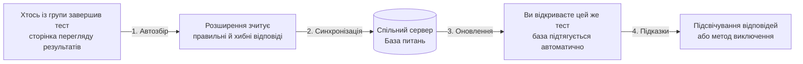

  
  <h1>Moodle Quiz Helper</h1>
  

    <b>Розумний помічник для тестів у Moodle, який автоматично зберігає перевірені відповіді, обмінюється ними з іншими користувачами та підсвічує підказки під час проходження тесту.</b>
  

  

    
    
    
    
  

---

## 📑 Зміст

- [Огляд інтерфейсу](#overview)
- [Як це працює](#how-it-works)
- [Основні можливості](#features)
- [Встановлення та підключення](#installation)
- [Налаштування розширення](#settings)
- [Розгортання власного сервера](#server-setup)

---

## 📸 Огляд інтерфейсу

> *Тут потім будуть фото :)*

---

## 💡 Як це працює

Розширення працює за принципом **спільної бази знань**: вам не потрібно нічого копіювати, зберігати вручну чи пересилати одногрупникам — усе відбувається у фоні.

1. **Автоматичний збір після тесту**
   Коли будь-хто з підключених користувачів завершує спробу та відкриває сторінку перегляду результатів (`review.php`), розширення самостійно зчитує питання, картинки та оцінки Moodle і відправляє їх на спільний сервер.
2. **Миттєвий обмін між користувачами**
   Щойно ви відкриваєте Moodle (або натискаєте **«Оновити базу з сервера»** у вікні розширення), воно завантажує всі нові відповіді, які встигли зібрати інші студенти.
3. **Розпізнавання перемішаних питань**
   Навіть якщо в тесті змінюється порядок питань або варіантів відповідей, розширення знаходить потрібний запис за внутрішнім ідентифікатором питання або за цифровим відбитком тексту та зображень.
4. **Підсвітка та метод виключення**
   Під час нової спроби розширення одразу позначає перевірені варіанти. Якщо точну відповідь ще ніхто не знайшов, але вже відомо, що всі варіанти, крім одного, неправильні — помічник вирахує правильний варіант самостійно.

---

## ✨ Основні можливості

### 1. Підсвічування відповідей під час тесту
- **Зелений (`✓ Правильно`)** — у базі є підтверджена правильна відповідь.
- **Червоний (`✕ Неправильно`)** — цей варіант уже обирали раніше, і він виявився хибним.
- **Синій (`✓ Виключенням`)** — правильна відповідь вирахувана автоматично шляхом виключення всіх хибних варіантів.
- Підтримуються тести з однією чи кількома відповідями, випадаючі списки у тексті, питання із зображеннями та таблиці відповідностей.

> *Тут потім будуть фото :)*

### 2. Індикатори на сторінці курсу
Навпроти кожного тесту у списку дисципліни з'являються компактні бейджі:
- **Прогрес спільної бази** (наприклад, `12 / 15 правильних` або `8 у базі • без ✓`) — показує, скільки питань цього тесту вже розв'язано на сервері.
- **Ваш особистий результат** (наприклад, `✓ 10/10`) — зберігається **лише у вашому браузері**, не передається на сервер і показує ваш найкращий бал за пройдений тест.

> *Тут потім будуть фото :)*

### 3. Адаптивний інтерфейс One UI
Вікно розширення автоматично підлаштовується під світлу або темну тему вашої системи. Поки сервер не підключено, відображається лише форма входу; після авторизації відкривається статистика бази та меню налаштувань.

> *Тут потім будуть фото :)*

---

## 🚀 Встановлення та підключення

1. Завантажте репозиторій (або розпакуйте архів із розширенням) у зручну папку на комп'ютері.
2. Відкрийте у браузері (Chrome, Edge, Brave, Opera) сторінку **`chrome://extensions/`**.
3. Увімкніть перемикач **«Режим розробника»** (*Developer mode*) у правому верхньому куті.
4. Натисніть **«Завантажити розпаковане розширення»** (*Load unpacked*) і виберіть папку з проєктом (де знаходиться файл `manifest.json`).
5. Натисніть на іконку **Moodle Quiz Helper** на панелі браузера, введіть **Адресу сервера** та **Секретний токен** (отримайте їх у адміністратора вашої групи) і натисніть **«Підключити»**.

---

## ⚙️ Налаштування розширення

У меню налаштувань доступні два швидкі перемикачі, які спрацьовують миттєво без перезавантаження сторінки:

- **Підказки** — вмикає або повністю приховує підсвічування відповідей у тесті та статистику спільної бази на сторінці курсу.
- **Показувати які тести пройшов** — керує відображенням ваших особистих локальних позначок проходження та балів біля тестів.

---

## 🖥️ Розгортання власного сервера

Якщо ви хочете підняти власний сервер синхронізації для своєї групи або курсу, перейдіть у гілку **`server`** — там знаходиться код бекенду та детальна інструкція із запуску через Docker або Node.js:

👉 **[Перейти до документації сервера](https://github.com/jermorg/Moodle-Quiz-Helper/tree/server)**
